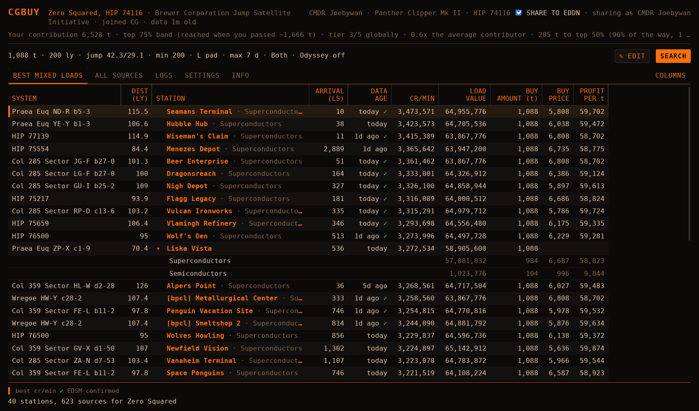
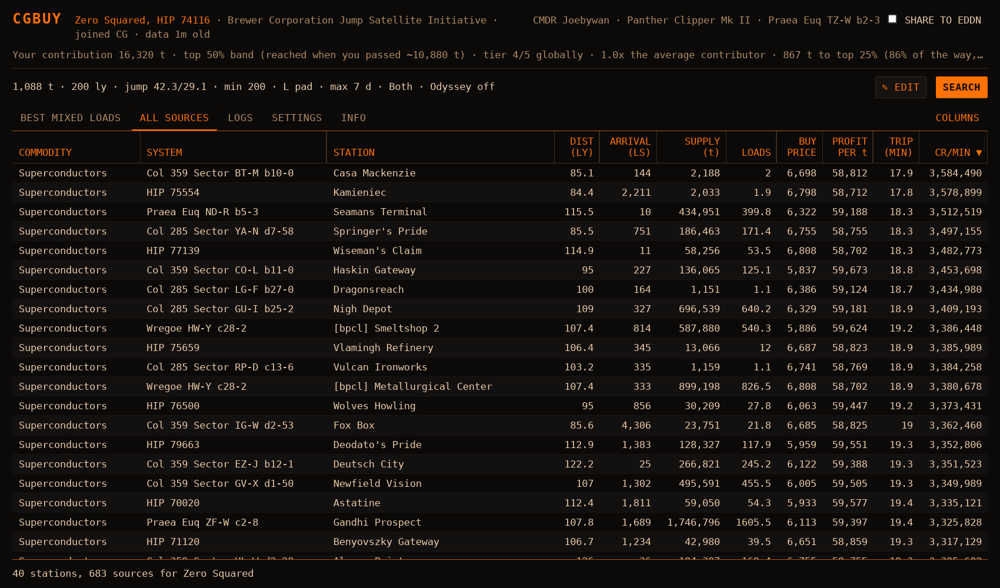
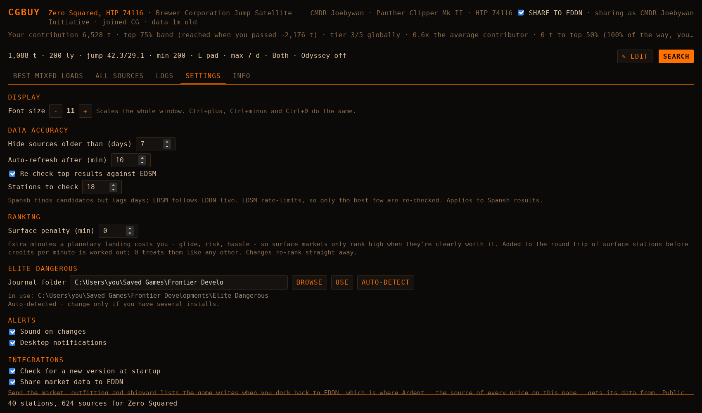
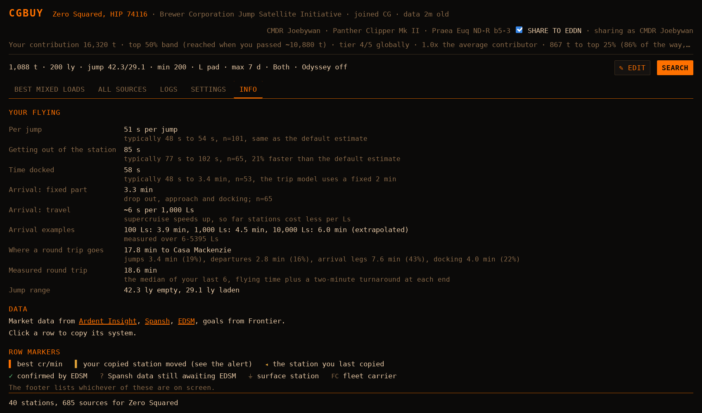

#  cgbuy

[](https://github.com/joebywan/ed-cg-buyfinder/actions/workflows/build.yml)
[](#antivirus)

Finds the best places to **buy** for an Elite Dangerous community goal, ranked
by credits per minute of round trip — not by profit per tonne, because a rich
station 40 minutes away loses to a decent one 15 minutes away.



It reads your journal to know which goal you joined, what ship you are flying
and how long your jumps actually take, then discovers candidate markets through
Spansh and re-checks the best of them against EDSM, which is days fresher.

The point is to stop bouncing between a dozen Inara tabs. Check a commodity,
note the station, check another, go back and refresh the first because the data
has moved, work out which of the two is actually closer, lose track of the
third, start again — arithmetic done in your head between page loads.
All of that belongs in one pane: a single window, a single ranked list, kept
current in place.

## Install

**No install at all:** the same app runs as a website at
<https://knowhowit.com.au/ed-cg-buyfinder/>. It reads your journal through the
browser (Chrome or Edge can keep watching the folder as you play) and takes its
markets from Ardent only; the desktop app below adds Spansh, the EDSM
re-check, desktop notifications and finds your journal folder by itself.

**Or download the desktop app:**

| | |
|---|---|
| [Latest release](https://github.com/joebywan/ed-cg-buyfinder/releases/latest) | stable, version-tagged |
| [Snapshot](https://github.com/joebywan/ed-cg-buyfinder/releases/tag/snapshot) | rebuilt on every push to `main` |

**Windows** — take `cgbuy-v<ver>-windows.zip`, extract it somewhere you will
find it again (not from inside the zip), and run `cgbuy.exe`. That is the whole
install: one file, nothing written to the registry, nothing set to run at
startup. The window is drawn by Microsoft's WebView2 runtime, which comes with
Windows 11 and up-to-date Windows 10; if `cgbuy.exe` will not open, install
the "Evergreen Bootstrapper" from
[Microsoft](https://developer.microsoft.com/microsoft-edge/webview2/).
`README-FIRST.txt` in the zip says the same for anyone who skips this page.

**Linux** — pick one:

- `cgbuy-v<ver>-linux.AppImage` — `chmod +x` it and run it. Carries its own
  WebKitGTK.
- `cgbuy-v<ver>-linux.deb` — `sudo apt install ./cgbuy-v<ver>-linux.deb`.
- `cgbuy-v<ver>-linux` — the bare binary (`chmod +x` first). It needs
  `libwebkit2gtk-4.1` installed.

A GitHub release asset cannot record the execute bit, which is why the
AppImage and the bare binary need the `chmod`.

Neither build is code-signed, so Windows SmartScreen will warn on first run
("More info" → "Run anyway") — see [Antivirus](#antivirus).

**Coming from the old Python/tkinter cgbuy?** This is a new app and replaces
it. Your settings carry over: on first run it reads the old `cgbuy.json` and
keeps its own in `cgbuy-desktop.json` beside it. The old app is gone from this
repository; its last release stays on the releases page.

**Run it from source** — Node 22+, Rust and `tauri-cli`; the full steps are in
[DEVELOPMENT.md](DEVELOPMENT.md):

```
git clone https://github.com/joebywan/ed-cg-buyfinder
cd ed-cg-buyfinder/app
node src-tauri/prep.mjs
cargo tauri dev
```

## What you are looking at

The **best mixed loads** view groups by station and shows what to buy there.
A station's most profitable commodity is often capped below your hold, so it
tops up with that station's next best — no extra travel, more credits.

A station that fills your hold with one commodity is a single line, with that commodity
next to its name. Only a mixed load (a short hold topped up with more products) has an
arrow: expand it for the per-commodity breakdown. Both views sort on any column
header — click once for high-to-low, again to reverse it. Or switch to
**all sources** for the flat one-row-per-commodity table. The tabs along the
top are **BEST MIXED LOADS**, **ALL SOURCES**, **LOGS** (what the app has been
doing, with COPY for bug reports), **SETTINGS** and **INFO**:



`SRC` says whether a row was verified against EDSM or is still Spansh's
figure, and `AGE` is colour-coded — stale supply is the single
biggest cause of a wasted trip.

Click any row to copy its system to the clipboard. A note saying so appears
next to the pointer and clears itself after a second and a half — nothing to
dismiss, since you do this every run.


## Destination



The tool works out where you are selling rather than asking:

1. **The community goal you joined.** Your journal records it — station,
   system and expiry — and Frontier's feed supplies that goal's commodity
   list.
2. **A live trade goal you have not joined.** If one is running it is used
   anyway — routes are never withheld — with a dismissible notice explaining
   that you need to sign up at the goal board first, since deliveries made
   before you register do not count. Dock at that station while still
   unregistered and it reminds you again, which is the one moment the
   reminder is worth anything. Everything clears the moment the journal shows
   you joining.
3. **Whatever you set by hand**, which always wins and is never overwritten.

The **DESTINATION** panel under the search controls takes a system (with name completion), then
`LOAD STATIONS` lists that system's markets, nearest arrival star first.
`CHOOSE FROM LIST` opens a filterable checklist of everything the destination
trades — type to narrow it, click to tick, `ADD SHOWN` to take every match at
once — so the commodity list never has to be typed out. `PREFILL FROM LIVE CG`
lists the running trade goals; `DERIVE FROM MARKET`
reads the market of the station you are docked at and picks out whatever it
pays a premium for — at a goal station that recovers the list exactly, and at
an ordinary station it finds what that place is short of.

No community goal anywhere? Set a station and it works as a plain hauling
tool.

## The idea

A run carries at most one hold of cargo. The time cost of the trip is the same
whether the hold is full of Water or full of Palladium, so **the tonnage per run
is capped by the hold, and the only thing that varies is profit per tonne.**
Haul the most valuable tonne you can fill the hold with.

That runs into supply. The station with the best profit/t often only has 200t of
it, well under an 800t hold. So the tool also builds **mixed loads**: for each
station it sorts that station's stock by profit per tonne and fills the hold
greedily — take all of the best commodity, top up with the next best, and so on.
The extra tonnage costs no extra travel, which is why a mixed load usually beats
the same station's single-commodity number.

Scoring: `cr_per_min = (tonnes loaded × profit per tonne) / estimated round-trip
minutes`. The round trip is jumps out (empty range) + jumps back (laden range) +
supercruise/approach at both ends + two departures (pad to first jump) + two
station turnarounds.

Filters applied when collecting sources: a landing pad your ship fits, supply
and buy price must be positive, profit must be positive, the station must be
inside the radius, and the market data must be newer than MAX AGE D. Surface
stations get a flat time penalty (Settings → *Surface penalty*, in minutes) added
to the round trip, so they only rank high when clearly worth the landing. Fleet
carriers are excluded unless you tick the box.

## Where the markets come from

**SOURCE** (desktop app) picks the market feed: **Ardent**, **Spansh**, or
**Both**. Ardent is built from EDDN and is fresh; Spansh finds more candidates
but lags by days, so with Spansh the best few stations are re-checked against
EDSM (Settings → *Re-check top results against EDSM*, *Stations to check*).
Their `AGE` then shows a green ✓ once EDSM confirmed the reading. **Both**
merges the two and keeps the EDSM-confirmed figures. EDSM rate-limits, so only
the top few are checked; the rest keep their dim ? until their turn.

## The two views

**BEST MIXED LOADS** — one row per station (expandable when the load mixes commodities), ranked by cr/min until
you click another header. The columns read where it is, then what it pays, then
what makes up the load: `SYSTEM`, `LY`, `STATION`, `LS`, `AGE`, then `CR/MIN`
(the plan's value over the trip estimate) and `VALUE` (tonnes × profit/t,
summed), then `TONNES`, `BUY` and `PROFIT/T`.

`TONNES` is what the station can actually fill, so a figure below your hold is a
station that cannot fill it. Expanding a mixed row puts each commodity in the mix in
the `STATION` column, with its own `TONNES`, `BUY`, `PROFIT/T` and `VALUE`.
`BUY` and `PROFIT/T` belong to those commodities rather than to the station, so
those two headers do not sort; every other one does. Whatever the order, the
best cr/min plan keeps its highlight, so re-sorting never loses it. Top 40
stations, none expanded until you open them.

The **COLUMNS** button on each table tab chooses which columns show and in what
order; you can also drag a header to move it and its right edge to resize.
Settings → *RESET COLUMNS* undoes it.

*Reading the table.* An orange bar on a row's left edge marks the best cr/min
station. An amber bar with an underline marks your copied station when the
target alert says it moved, until you press GOT IT. `◂ copied` tags the station you
last copied. On `AGE`, a green ✓ means EDSM confirmed the reading and a dim ?
means Spansh data still waiting for its EDSM check. Hover a row for the same
explanation; the footer legend lists whichever markers are on screen, and the
**INFO** tab explains all of them, with the credits, the version and the update status.
It also shows **YOUR FLYING**, the jump, docking and arrival times measured from your journal that the
trip estimates use:



Once results are up, the search controls and DESTINATION fold into one summary line
(with SEARCH still on it); ✎ EDIT unfolds them until the next search. Alerts: a banner
appears only when the station you copied (the *target*) moves, drops out or is hidden by a
filter, when your reward tier changes, or when EDSM has been rate-limiting for 5+ minutes
with stations still unconfirmed. Nothing else raises one. *Sound on changes* (Settings)
adds a chime to those.

**ALL SOURCES** — one row per commodity-at-station, click any header to sort.

| Column | Meaning |
| --- | --- |
| `LY` | distance from the destination system |
| `LS` | arrival distance of the source station from its star |
| `SUPPLY` | tonnes on offer |
| `LOADS` | how many full holds that supply covers |
| `BUY` | price per tonne at the source |
| `PROFIT/T` | CG sell price minus buy price |
| `TRIP` | estimated round-trip minutes |
| `CR/MIN` | credits per minute for a single-commodity run |
| `T/MIN` | tonnes per minute — use this if you care about CG rank rather than credits |
| `AGE` | how long ago a commander last reported this market; green ≤2 days, amber ≤7, red beyond — a CG drains supply fast |

Hover the destination at the top to see what the CG pays per tonne for each
commodity (the CG multiplier is already baked into the EDSM price — the tool
does not apply it). It is a hover rather than a row of its own because every
one of those prices is already inside the `PROFIT/T` beside it.

**Hover any station row, in either table, to see which body it is.** `LS` says
how long the approach is; it does not say whether it ends at a starport you
dock at or a pad you have to glide down to — and if it is a surface, which rock
you set course for. The hover says that, with the body's type and surface
gravity when it is one you land on. A carrier says so instead, because it
orbits nothing and can leave.

The two halves come from different places. Spansh names the body for a surface
station, so that answer is already in hand. It records nothing at all for an
orbital starport — not in its station index and not in its system dump — so the
body a starport orbits is asked of EDSM, once per system, only for a row you
actually pointed at, and it fills itself in a moment later. A system the search
already re-checked against EDSM costs nothing, because it is the same response.

## On the way in

If you are further from the goal station than your search radius (you have just heard about the CG and have a
trip ahead of you), an **ON THE WAY IN** panel appears under the mixed table. Sign-up and hand-in happen at the
same dock, so arriving with a full hold means the first run is already done. It goes away once you are inside
the radius.

Press **FIND LOADS ON THE WAY** and cgbuy asks Ardent for the goal's commodities within 200 ly of where you are
(your position comes from the journal's last jump), then lists the five best holds that cost little extra
flying. A station qualifies when going via it adds no more than 15% of the direct trip, or two laden jumps,
whichever is larger; `DETOUR LY` is that extra distance. They are ranked by what a full hold earns
(`VALUE`, tonnes × profit/t), and clicking a row copies its system as usual. Nothing is fetched until you press the
button, and it is not repeated as you jump; press **REFRESH** after you have moved a long way.

It needs Ardent: the panel only appears when the main search used it (the default), because Spansh does not
give the goal's coordinates. Since Ardent searches around a system, the 200 ly circle is centred on you, not on
the middle of the route, so on a very long trip it finds loads near the start rather than along the whole way.

## Interface

Inputs across the top: hold size, radius (120 ly), jump range empty and laden,
minimum supply (200), landing pad, how old a source may be, the SOURCE, and
toggles for fleet carriers and Odyssey. Enter or SEARCH runs it.

If fewer than 5 stations are in range, the app keeps going: every selected source
is asked again 1.5x further out (180, 270, ... up to 500 ly), the results merged,
and the decision made only once all of them have answered. Spansh is asked for
just the new ring, so nothing is paged twice; Ardent only takes a maximum
distance and is simply asked again. Each step is shown as it lands and narrated
in the status line, the progress panel and LOGS. Your radius setting is unchanged;
stations beyond it carry a dim ⤢. Filter changes that leave fewer than 5 widen
too. Switch it off, or change the max, in SETTINGS.

**ODYSSEY** decides whether stations on a planet surface are candidates at all
— settlements, planetary outposts and ports. It is off by default because a
surface market is a different trip from a starport: a glide down, a pad on a
rock, and a client that owns the expansion. The first time your journal names a
game it sets the box for you from what that game is running; after that the
choice is yours and it is remembered. Hover a row to see which body you would
be landing on.

**When Spansh will not answer for a commodity, the status bar says so.** It
sheds load rather than queueing, so a busy evening returns 502s; those pages
are asked for again, and a commodity it still will not answer for is named in
amber, because nothing from it is in the ranking. The line above it counts what
the *destination* pays for, which is not the same as what got searched — so
without this a search missing a quarter of the goal read exactly like a
complete one.

**What the age filter did has its own line, under the table, always.** Sources
older than the cutoff (Settings → DATA ACCURACY, 7 days by default) are dropped
during the fetch, and the line says how many out of how many — or says nothing
was hidden, which is worth reading too. Raise the cutoff and the search re-runs,
because the rows it hid are not held anywhere to un-hide. If *every* source is
older than the cutoff the filter stands down rather than leave you an empty
table, and the line says so.

The title line carries the destination and how old the data on screen is. The
status bar is the search's own line — what was found, what was hidden, what
went wrong. Nothing else lives in either: a progress bar you have finished
reading is a full-width orange rule saying nothing, so it is only there while
a search runs.

Hold and the two jump ranges are marked `*` and locked while your journal can
see a ship — they are the ship's, not yours to guess at. Hover one to see
where its number came from. See [Ship detection](#ship-detection).

**Font scaling.** Ctrl+`+` / Ctrl+`-` (Ctrl+`0` resets), or Settings → DISPLAY,
rescales the whole window — fonts, row heights, column widths — and the choice
is saved.

**Settings** (SETTINGS tab): display font size, how old a source may be (7
days), how many minutes cached results count as fresh (10), the surface penalty,
the EDSM re-check and how many top results it covers (18), the journal folder
(auto-detected; override only if you have several installs), toggles for the
update check, desktop notifications and EDDN, column reset, and a readout of
current trip timings with a reset.

On startup the last results are shown straight away; if they are older than
the freshness window a new search runs behind them without asking.

**Config** lives in `cgbuy-desktop.json` in your config folder (see
[Windows and macOS](#windows-and-macos)) and holds font size, journal path,
search parameters, columns, the Odyssey toggle, the integration toggles, EDSM
verification settings and accumulated calibration samples. The old app's
`cgbuy.json`, if present, is read once to carry those over.

## Journal calibration

The shipped trip model is guesswork: 0.85 min per jump, 1.8 min from the pad to
the first jump, and a supercruise curve (`0.25 × Ls^0.3`) fitted by eye. The app
tails your Elite journals and replaces those guesses with what actually happens
to you:

- **jump cycle** — FSDJump to FSDJump, counted only when 15–300s apart, so a stop
  mid-route is not charged as jump time. It prices the jumps *after* the first:
  the first one's cost is already inside departure and the arrival leg, so a
  route of N jumps is charged N−1 cycles
- **departure** — Undocked to the first FSDJump: launch, clear mass lock, align,
  charge
- **arrival leg** — FSDJump to Docked, i.e. supercruise plus approach plus
  docking, paired with the station's arrival Ls

**Station time is not calibrated.** Docked to Undocked cannot tell trading apart
from making a cup of tea, so the trip model uses a fixed 2-minute turnaround.
The median stop is still collected and shown in the timings readout.

Each measurement needs **at least 3 samples** before it is used at all, and the
value is a median, so one 500,000 Ls outlier cannot swing it. Until then the
estimate stands, and the status bar says `estimate (n=…)`. On first run it
back-fills from your last six journal files. It keeps the most recent 200
samples of each kind in the config.

**The arrival leg is fitted, not scaled.** Most of a leg is fixed cost — drop,
approach, request docking, land — with travel on top, so one multiplier on a
distance curve cannot fit both ends. On the journals this was written against,
two stations 15× apart in arrival distance were 18% apart in time, and the
single ratio that "fitted" them ran 22% fast at one and 57% slow at the other.
Once you have flown legs at arrival distances at least 3× apart, the fixed cost
and the travel term are fitted separately, on bucket medians so a station farmed
for a hundred runs cannot outvote one visited twice. Beyond the range you have
actually flown the estimate curve's shape takes over again — two clusters of
samples say nothing about what 40,000 Ls costs, and a straight line through them
would cheerfully claim it is quick. Below 3× spread, the old ratio stands in.

This matters more than it sounds: the destination's own arrival leg is paid on
every run, and because the error ran the wrong way at each end it was not a flat
offset — distant sources were being pushed down the rankings and near ones
pulled up.

Docking at the destination station triggers an automatic re-search — the run
just ended, so the next one gets fresh data.

**The reward-tier ETA uses your real runs, not the model.** Once three runs are
on record, the `% to next tier` tooltip plans on the median of your **last six**,
and the model only stands in until then.

A run is measured pad to pad at the CG station, but counts only the part you
spend **flying**, plus a flat two minutes at each end — the same two minutes the
trip model prices a stop at. Time parked is not piloting: `Docked → Undocked`
cannot tell restocking from making a cup of tea, and wall-clock dock-to-dock
turned a 14-minute run into a 102-minute one every time its commander stood up.
A run also has to include a stop somewhere else, so leaving the pad and coming
straight back is a repair, not a round trip, and over four hours in flight is a
log-out in supercruise rather than a very slow run.

The upshot is a number that moves when your flying does: tighten the loop and
the estimate follows within two or three runs.

## EDDN sharing

**Off by default, opt-in in Settings.** When on, every time the game writes one
of its station files — a `Market`, `Outfitting` or `Shipyard` journal event —
the tool sends that station's list to EDDN, the same way EDMC does:

| Schema | From | What it carries |
| --- | --- | --- |
| `commodity/3` | `Market.json` | the price/stock/demand table |
| `outfitting/2` | `Outfitting.json` | the module names on sale |
| `shipyard/2` | `Shipyard.json` | the hulls on sale |

Only the first is data this tool reads back. The other two are given rather
than taken — they cost nothing, because those files are already in the folder
being tailed, and somebody else's route planner needs them.

Every message carries the system, station, market ID, timestamp and the
Horizons/Odyssey flags, and nothing else — no position, no ship, no cargo.
Limpets and non-marketable goods are stripped from the market table; the
planet approach suite is stripped from the module list, because every hull has
one and its presence says nothing about the station. Module names are spelled
the way EDMC spells them, so consumers see one string from both uploaders.

**Your commander name is the uploader ID**, exactly as every other uploader
does it: public and pseudonymous. Messages are validated locally against the
schema before sending — all three set `additionalProperties: false`, so one
stray key rejects a whole message — and each snapshot is sent at most once.

Two details worth knowing, both learned from real files. The game repeats
module names (484 entries, 465 distinct in one reading) and the schema demands
unique ones, so the list is de-duplicated or it would be rejected outright.
And `Outfitting.json` and `Shipyard.json` sit on disk from the last station
that *had* that service, so each upload is checked against the market ID the
journal event just named — otherwise a shipyard three systems back gets
republished as this one.

Everything this tool reads came from someone else doing this, which is the
argument for turning it on.

## Update check

**Off by default, opt-in in Settings** (*Check for a new version at startup*).
When on, the app asks GitHub once as it opens what the latest release is. If
that is newer than what you are running, a line appears in the status bar —

> New version 1.7 available

— and clicking it opens the releases page in your browser. That is the entire
feature. It is not an updater: nothing is downloaded, nothing is replaced, and
the app never opens a browser on its own. The Windows build scans clean
precisely because nothing in it fetches or runs code, and that is not being
traded away for convenience.

One request per run, no polling, and nothing about you is sent — it is a plain
`GET` of the public releases endpoint, with the same User-Agent every other
call uses. If it fails for any reason at all — offline, blocked, rate-limited,
GitHub having a bad day — it says nothing rather than reporting an error at
you. There is no second prompt and nothing to dismiss: the line is either
there or it is not.

Running from source? The notice still appears, and `git pull` is your update.
The website needs no update: it is always the latest.
The rolling [snapshot](#install) build is a pre-release, so it is never
offered as an update to anyone.

## Limitations

- **Trip times are estimates.** Even calibrated, they are medians of your past
  flying, not a prediction of this run. Interdictions, traffic, and a bad
  approach are not modelled.
- **Market data is only as fresh as the last commander to visit.** Supply drains
  fast during a CG, and a station showing 40,000t three weeks ago may be empty.
  Watch the AGE column; it is coloured for exactly this reason.
- **Fleet carriers move and reprice.** Off by default for that reason.
- **The Linux builds are made on Ubuntu 22.04**, so they may not start on a
  distro older than that. Build it locally if so.
- **No macOS build.** Nothing builds one; Tauri can, from source, but it is
  untested.
- **The website cannot use Spansh or EDSM**, which do not let other web pages
  read their data, so it uses Ardent alone and has no desktop notifications.

## Windows and macOS

What adapts automatically:

- **Journals** — `%USERPROFILE%\Saved Games\Frontier Developments\Elite Dangerous`,
  including the OneDrive-redirected variant, plus Steam libraries on other
  drive letters. Override it in Settings if detection misses.
- **Config** — `%APPDATA%\cgbuy-desktop.json` on Windows,
  `~/Library/Application Support` on macOS, `~/.config` elsewhere.
  `XDG_CONFIG_HOME` always wins if set.

## Antivirus

**The Windows download is a single `cgbuy.exe` in a zip, and it scans clean on
VirusTotal: 0 detections of 75 engines** when this build was previewed on its
pull request. Every release scans itself: after a version is published CI
submits the Windows zip and the Linux binary and appends the counts, hashes and
the names of any flagging engines to the release notes, so anyone forwarded an
alarming-looking scan link finds the same figures already on the download page.
The badge at the top follows the Windows zip.

It is **unsigned**, so Windows SmartScreen may warn on first run ("More info" →
"Run anyway"). A certificate is a recurring annual cost and this is a free tool
written for its author's own use; sharing it is a courtesy. A heuristic engine
may also flag an unsigned exe from a project with no reputation, and detections
can come and go. The one packaging choice that mattered: the Windows build
ships as a portable zip with no installer, because the same exe wrapped in an
NSIS setup drew 3 generic heuristic hits while the bare exe drew none.

If something is flagged:

- **Use the website** — <https://knowhowit.com.au/ed-cg-buyfinder/>, nothing to
  download.
- **Run from source** — see [Install](#install). No binary, and the source is
  all in this repository.
- **Check the hash.** `Get-FileHash` on Windows, `sha256sum` elsewhere, against
  the figures in the release notes.
- **Read the sandbox report** rather than the score. The relevant question is
  what it did: contacted hosts, files written, processes spawned.

## Notifications

The window normally sits behind the game, so it can tell you when something
changes rather than waiting to be looked at. **Off by default; turn it on with
Desktop notifications in Settings** (the app asks the OS for permission). It
notifies when:

- **the best target changed** — a different station is now top, usually
  because the previous one drained or fresher data arrived
- **the station you copied moved or dropped out** — the same event as the
  in-app alert
- **a trading goal is running that you have not joined**, or you dock at its
  station unregistered — deliveries before you sign up do not count

They are delivered through the OS's own notification system. *Sound on
changes* is separate and adds a chime to the in-app alerts.

The status bar also shows how long ago the shown data was fetched, ticking
live and turning amber once it passes the auto-refresh threshold — so you can
tell at a glance whether docking at the destination actually refreshed it.

## Ship detection

Hold size, jump ranges and landing-pad class are read from the game's
`Loadout` event, not typed in. **While a journal is readable it is the source
of truth**: those boxes show the ship's own figures, are locked, and update
themselves. They unlock only when no journal names a ship — with nothing to
read, your estimate is all there is, and it is remembered between sessions.
(The starter-hauler numbers behind them are deliberately small: too small is
visibly wrong, whereas a plausible big-ship number would just be believed.)

Swapping ships, refitting, or flying a longer laden jump than before all
update the toolbar live, without a restart. A swap is taken from `Loadout`,
`ShipyardSwap`, `ShipyardNew` or `LoadGame`, and the previous ship's figures
are dropped the instant the hull changes rather than lingering — priming reads
several journals back, so a swap is ordinary, and a Panther's 832t hold on a
Cobra would plan confident runs you cannot fly. Between the swap and the new
`Loadout` the status bar says so. Once the new figures land, the results are
re-run automatically: pad class decides which stations are eligible at all, so
what was on screen was about a ship you are no longer flying.

Laden jump range is the one the game never reports. It is derived from the
mass ratio — FSD range is inversely proportional to total mass, so the unladen
maximum scales by `(hull + fuel) / (hull + fuel + cargo)` — and then floored by
the longest jump you have actually made with cargo aboard, which is hard
evidence no formula can argue with.

This matters more than it sounds. An underestimate makes the tool think the
return leg needs an extra jump, inflating every trip time and quietly biasing
the ranking against the nearer stations.
